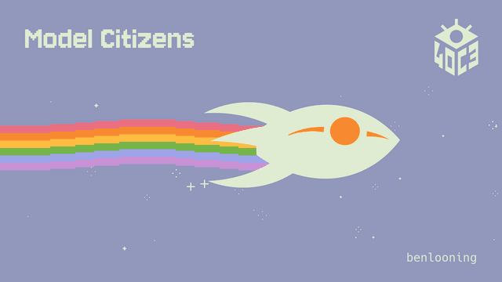
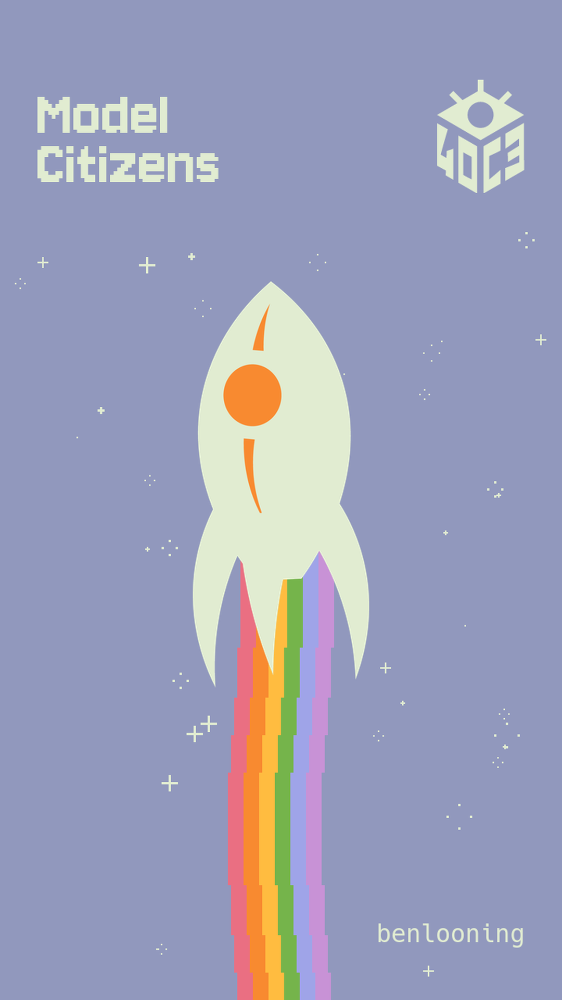

# 40C3 Rainbow Fairydust

**Model Citizens. Rainbow propulsion. A little organized chaos.**

A Nyan Cat-inspired Fairydust animation for **40C3**, made by **benlooning**.
Original Congress vector artwork meets a pixel rainbow, sparkling stars and a
60-second synthesized anthem. Available in landscape and upright phone formats.



*Unofficial community project. Built from the [official 40C3 styleguide](https://events.ccc.de/congress/2026/infos/styleguide/).*

## Watch & download

The ready-to-play videos include the full 60-second anthem:

- **[Landscape video · 16:9](https://github.com/benlooningus/40c3-rainbow-fairydust/releases/download/v1.0.0/40c3-fairydust-16x9-sound.mp4)**
- **[Phone video · 9:16](https://github.com/benlooningus/40c3-rainbow-fairydust/releases/download/v1.0.0/40c3-fairydust-9x16-sound.mp4)**
- [Release notes and source downloads](https://github.com/benlooningus/40c3-rainbow-fairydust/releases/latest)

## Two formats, one anthem

| | Landscape | Phone |
| --- | --- | --- |
| Aspect ratio | 16:9 | 9:16 |
| Resolution | 1920 × 1080 | 1080 × 1920 |
| Flight direction | Right | Up |
| Video with music | 60 seconds · H.264 + AAC stereo | 60 seconds · H.264 + AAC stereo |
| Silent animation loop | 4 seconds · 30 fps | 4 seconds · 30 fps |

The rocket moves smoothly while the pixel stars flicker through short, discrete
sparkle phases. The rainbow meets the rocket without a gap. **Model Citizens**
uses Jersey 10; **benlooning** uses Hack. Everything is rendered locally, without
a browser, external API or online rendering service.

<details>
<summary>See the upright phone composition</summary>

<p align="center"></p>

</details>

## Make the videos

You need **Python 3.10+** and **FFmpeg** with `ffprobe` and H.264 encoding support
on your PATH. Node.js is only needed if you want to regenerate the music.

From the repository folder:

```sh
python3 -m venv .venv
.venv/bin/python -m pip install -r requirements.txt
.venv/bin/python render.py
.venv/bin/python add_sound.py
```

On Windows, use `.venv\Scripts\python.exe` instead of `.venv/bin/python`.

The included lossless soundtrack is ready to use. Both scripts resolve files
relative to their own location, so you can also run them from another directory.

### Your finished files

All generated files go into **`build/`**:

| File | What you get |
| --- | --- |
| `40c3-fairydust-16x9-sound.mp4` | Full landscape video with the anthem |
| `40c3-fairydust-9x16-sound.mp4` | Full upright phone video with the anthem |
| `40c3-fairydust-16x9.mp4` / `40c3-fairydust-9x16.mp4` | Silent four-second loops |
| `*-preview.png` / `*.gif` | Still and animated previews |

The four-second animation repeats 15 times under the complete 60-second track.
The audio step copies the encoded picture without another video compression
pass. MP4 sound is AAC stereo at 320 kbit/s; the source master is lossless FLAC.
MP4 and GIF exports contain 30 frames per second; GIF timing uses alternating
30/30/40 ms frame durations to fit its centisecond time base.

Render a single layout with `render.py --format landscape` or
`render.py --format portrait`. The audio script combines **both** silent videos,
so both must exist before running it. To use your own soundtrack:

```sh
.venv/bin/python add_sound.py --audio /path/to/your-track.wav
```

The animation repeats for the duration of the supplied audio.

## Make the music, too

The original anthem is **Model Citizens – 40C3 Rainbow Anthem (Pure Banger)**:
128 BPM, 32 bars, 60 seconds, 48 kHz stereo. Its synthesis and arrangement live
in a single JavaScript file, with no npm dependencies.

With **Node.js 18+** and FFmpeg installed:

```sh
node music/render.mjs
.venv/bin/python add_sound.py --audio build/audio/soundtrack.flac
```

This writes fresh WAV and FLAC masters into `build/audio/`. The original master
in `assets/` remains untouched. Noise and oscillator phases are randomized, so
a fresh synthesis is not bit-for-bit identical to the bundled recording.

## Remix it

Start with `Scene` in **`render.py`**. Colors, layout, type sizes, star phases and
flight motion are kept together there. The format flag selects the composition.
**`add_sound.py`** handles soundtrack duration and muxing. **`music/render.mjs`**
contains the instruments, notes and arrangement.

The original SVG files are retained in `assets/`. Recoloring, rotation and
removal of the oval and original exhaust happen during rendering. Only the two
graphics, two fonts and one audio master used by this project are bundled.

## Design, credits & licenses

**Code and documentation: [MIT](LICENSE). Original soundtrack and animation:
[CC BY 4.0](licenses/MEDIA.md), credited to benlooning.** Upstream graphics and
fonts keep their own licenses.

| Component | Credit / license |
| --- | --- |
| Fairydust, 40C3 logo, rainbow palette | CCCV / 40C3 design team · CC0 |
| Jersey 10 | Sarah Cadigan-Fried · SIL Open Font License 1.1 |
| Hack | Source Foundry and upstream contributors · bundled license notices |
| Animation and project | benlooning |
| Anthem source package | benlooning & Antigravity · MIT |

The lavender background and cream foreground follow colors sampled from
styleguide screenshots. The rainbow uses six values from the official palette.

Useful references:

- [Official 40C3 styleguide and design concept](https://events.ccc.de/congress/2026/infos/styleguide/)
- [Complete official asset package](https://events.ccc.de/congress/2026/infos/styleguide/40c3-styleguide-full-latest.zip)
- [Jersey typeface source](https://github.com/scfried/soft-type-jersey)
- [Hack typeface source](https://github.com/source-foundry/Hack)
- [40C3 community project listings](https://events.ccc.de/congress/2026/infos/hub-projects/)
- [Full asset provenance, modifications and license notices](THIRD_PARTY.md)

This is a fan-made community contribution, not an official CCC or CCCV release.
The rainbow/star concept is inspired by Nyan Cat; no original Nyan Cat artwork
or recording is included. AI tools assisted the development of the project.

## Share a release

Keep generated media out of Git: `build/` is ignored. Upload the two `*-sound.mp4`
files as assets on a GitHub Release so viewers can download them directly.
The source repository includes everything needed to render them again.

When sharing or remixing, credit **benlooning**, link the relevant licenses and
note your changes. Preserve the upstream font notices when redistributing fonts.
